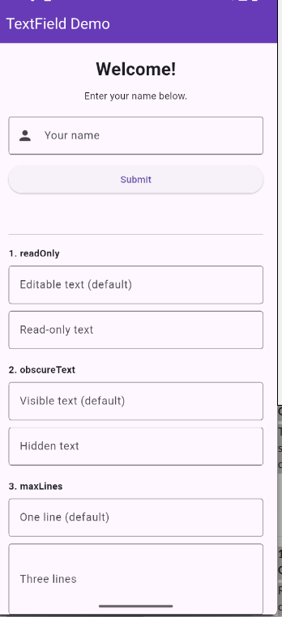
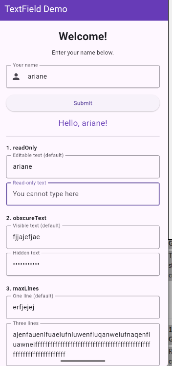
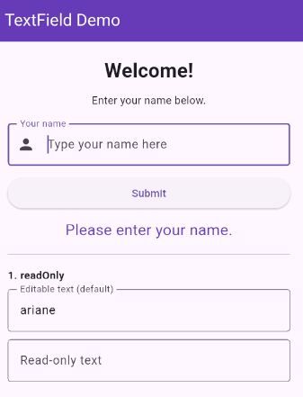

# TextField Demo

A Flutter demo of `TextField` in a simple name-entry form, with examples of read-only input, hidden text, and multi-line input.

## Run

1. Install the Flutter SDK.
2. Open this project directory in a terminal.
3. Run `flutter pub get`.
4. Run `flutter run`.

## Three TextField properties

- **`readOnly`**  Defaults to `false`, so the field can be edited. Setting it to `true` prevents edits while still displaying the value, useful for fields such as generated references.
- **`obscureText`**  Defaults to `false`, so entered characters are visible. Setting it to `true` hides them, which is useful for password-like input.
- **`maxLines`**  Defaults to `1`. Setting it to `3` makes the field taller for multi-line input, useful for longer notes or messages.

## Screenshots

Initial form:

Entered name and property examples:

Empty-name validation:

## Presentation date

October 12, 2026
